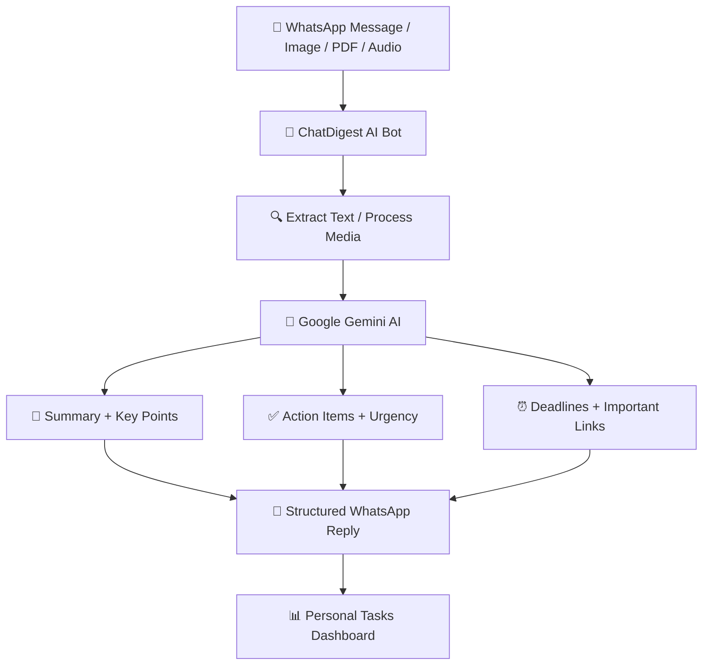

# 🚀 ChatDigest AI — Turn Chat Chaos into Clarity!

<p align="center">
  <b>Stop Scrolling. Start Knowing.</b><br/>
  Your AI-powered WhatsApp assistant that turns endless messages into actionable insights.
</p>

<p align="center">
  
  
  
  
</p>

---

## 💡 The Problem

Important information gets lost in the noise.

Students miss assignment deadlines. Employees overlook important meetings. Society members miss announcements. Why? Because critical information is buried under hundreds of WhatsApp messages, emojis, forwarded notices, and casual conversations.

**What if you could turn all that chaos into clarity in seconds?**

## ✨ Introducing ChatDigest AI

ChatDigest AI is an intelligent WhatsApp assistant that transforms unstructured conversations and documents into concise, actionable summaries using AI.

Simply forward a message, share a screenshot, upload a PDF, or send a voice note. ChatDigest AI extracts what matters and delivers an organized digest so you can focus on taking action instead of scrolling endlessly.

**No more information overload. No more searching through hundreds of messages. Just clarity.**

## 🎯 Key Features

| Feature | What it does |
|---|---|
| 📌 Smart Summaries | Converts lengthy conversations into concise TL;DR summaries |
| 🗒️ Key Points | Extracts only the most important information |
| ✅ Action Items | Identifies tasks, responsible persons, and urgency |
| ⏰ Deadline Detection | Extracts dates, times, and important submission deadlines |
| 🔗 Link Preservation | Preserves important URLs from the original content |
| 🖼️ OCR Intelligence | Extracts text from screenshots and images |
| 📄 PDF Processing | Summarizes notices, circulars, and documents |
| 🎙️ Voice Note Support | Processes audio using AI-powered capabilities |
| 🌍 Multilingual AI | Supports Hindi, Hinglish, English, and other detected languages |
| 💬 Follow-up Questions | Ask for shorter summaries, translations, or deadline clarification |
| 📲 WhatsApp Integration | Interact through WhatsApp without installing another app |
| 📊 Task Dashboard | View and organize important tasks through a web interface |
| 🔒 Privacy-First Design | Includes a delete-my-data command and aims to minimize data retention |

## ⚡ How It Works



1. **Send:** Forward a conversation, screenshot, PDF, or voice note.
2. **Analyze:** The bot processes the content using the appropriate AI capabilities.
3. **Extract:** Important information, tasks, deadlines, and links are identified.
4. **Summarize:** The content is converted into a clear, structured digest.
5. **Act:** Review the response and use the extracted information to stay organized.

## 📋 Example Output

Imagine your college group sends 200 messages about an upcoming practical examination.

Instead of reading everything, ChatDigest AI gives you:

> **📌 TL;DR**
>
> The chemistry practical examination is scheduled for 20 November. Students must complete their lab records before the examination.
>
> **🗒️ Key Points**
>
> - Practical examination: 20 November
> - Lab records must be completed
> - Students should bring the required materials
>
> **✅ Action Items**
>
> - 🔴 Complete the lab record — all students
> - 🟡 Prepare the practical materials — all students
>
> **⏰ Deadlines**
>
> - Practical examination: 20 November
>
> **🔗 Important Links**
>
> - Original links are preserved when available in the source content.

*Example output is illustrative; extracted details depend on the actual messages provided.*

## 🛠️ Tech Stack

<p align="center">
  
</p>

- **Runtime:** Node.js
- **Backend:** Express.js
- **AI Engine:** Google Gemini — text, vision, and audio capabilities
- **Messaging:** Meta WhatsApp Cloud API
- **Media Storage:** Cloudinary
- **Deployment:** Vercel
- **Dashboard:** Web-based personal task interface

## 🏗️ Project Architecture

```text
ChatDigest-AI/
│
├── public/              # Web interface and dashboard assets
├── src/                 # Application logic (if applicable)
├── routes/              # API routes (if applicable)
├── services/            # AI and media processing (if applicable)
├── server.js            # Express server entry point (example)
├── package.json         # Dependencies and scripts
├── .env.example         # Environment variable template
├── .gitignore           # Files excluded from Git
└── README.md            # Project documentation
```

*The directory structure above is illustrative. Adjust it to match the actual files in your repository.*

## 🚀 Getting Started

Want to run ChatDigest AI locally? Follow these steps.

### Prerequisites

Make sure you have:

- [Node.js](https://nodejs.org/) installed
- A [Google AI Studio](https://aistudio.google.com/) API key
- A Meta developer account with WhatsApp Cloud API access
- A [Cloudinary](https://cloudinary.com/) account if using media uploads
- Git installed on your system

### 1. Clone the Repository

```bash
git clone <YOUR_REPOSITORY_URL>
cd <YOUR_REPOSITORY_FOLDER>
```

Replace the placeholders with your actual GitHub repository URL and folder name.

### 2. Install Dependencies

```bash
npm install
```

### 3. Configure Environment Variables

Create a `.env` file in your project root and configure the credentials required by your application.

Example template:

```env
PORT=3000

GEMINI_API_KEY=your_gemini_api_key

WHATSAPP_ACCESS_TOKEN=your_whatsapp_access_token
WHATSAPP_PHONE_NUMBER_ID=your_phone_number_id
WHATSAPP_VERIFY_TOKEN=your_webhook_verify_token
WHATSAPP_APP_SECRET=your_meta_app_secret

CLOUDINARY_CLOUD_NAME=your_cloud_name
CLOUDINARY_API_KEY=your_cloudinary_api_key
CLOUDINARY_API_SECRET=your_cloudinary_api_secret
```

**Important:** These are example variable names. Use the exact names expected by your source code and configure only the services your application requires. Never commit your real API keys or access tokens to GitHub.

### 4. Start the Application

Use the start command defined in your `package.json`. For example:

```bash
npm start
```

If your project uses a development script, you may be able to run:

```bash
npm run dev
```

### 5. Configure the WhatsApp Webhook

1. Open your Meta developer application.
2. Configure the WhatsApp product and webhook URL.
3. Set the callback URL to your deployed HTTPS endpoint.
4. Configure the verification token expected by your application.
5. Subscribe to the required message events.
6. Send a test message to your connected WhatsApp number.

Follow the webhook routes and setup requirements implemented in your actual project.

## 🌐 Live Demo

🚀 **Try ChatDigest AI:** [Add Your Live Demo URL](https://vercel.com/)

💻 **Source Code:** [View the GitHub Repository](https://github.com/)

Replace these links with your actual deployment URL and repository URL before publishing.

## 🔐 Privacy & Security

Privacy matters when working with personal conversations and documents.

ChatDigest AI is designed with a privacy-first approach:

- Minimize unnecessary data retention.
- Provide a delete-my-data command.
- Keep API credentials in environment variables.
- Avoid exposing sensitive information in logs.
- Configure media retention and deletion according to your requirements.

**Transparency matters:** Temporary uploads, AI-provider processing, application logs, and platform-side retention may still apply. Do not claim that all data is automatically deleted or that no data is stored unless your implementation and provider settings guarantee it.

## 🌍 Who Can Use ChatDigest AI?

🎓 **Students:** Never miss assignment deadlines, practicals, or examination announcements.

💼 **Professionals:** Extract tasks, meeting details, and action points from busy work groups.

🏘️ **Housing Societies:** Stay updated on maintenance notices, meetings, and community announcements.

👥 **Teams:** Turn unstructured discussions into organized, actionable information.

📚 **Anyone:** Spend less time scrolling and more time doing what matters.

## 🚧 Future Enhancements

Ideas for expanding the project include:

- 📅 One-click calendar integration for extracted deadlines
- 🔔 Automated reminders for upcoming tasks
- 🧠 Personalized summaries based on user preferences
- 📊 Advanced task management and progress tracking
- 🌐 Support for additional languages
- 👥 Group-specific summaries and recurring reports
- 🔎 Searchable history of saved digests, with user-controlled retention
- 📈 Productivity analytics and missed-deadline tracking

## 🤝 Contributing

Contributions, suggestions, and bug reports are welcome!

1. Fork the repository.
2. Create a feature branch.
3. Make your changes.
4. Test your implementation.
5. Submit a pull request describing your improvements.

For major changes, open an issue first to discuss your proposed feature.

## 📜 License

Add a `LICENSE` file and specify your chosen license before publishing. If no license is provided, the repository is not automatically open source for unrestricted reuse.

## ⭐ Support the Project

If you find ChatDigest AI useful, consider giving the repository a ⭐ on GitHub!

Share it with students, developers, and anyone tired of missing important information in endless group chats.

---

<p align="center">
  <b>🚀 ChatDigest AI</b><br/>
  Turn Chat Chaos into Clarity.<br/><br/>
  <i>Less scrolling. Fewer missed deadlines. More productivity.</i>
</p>
